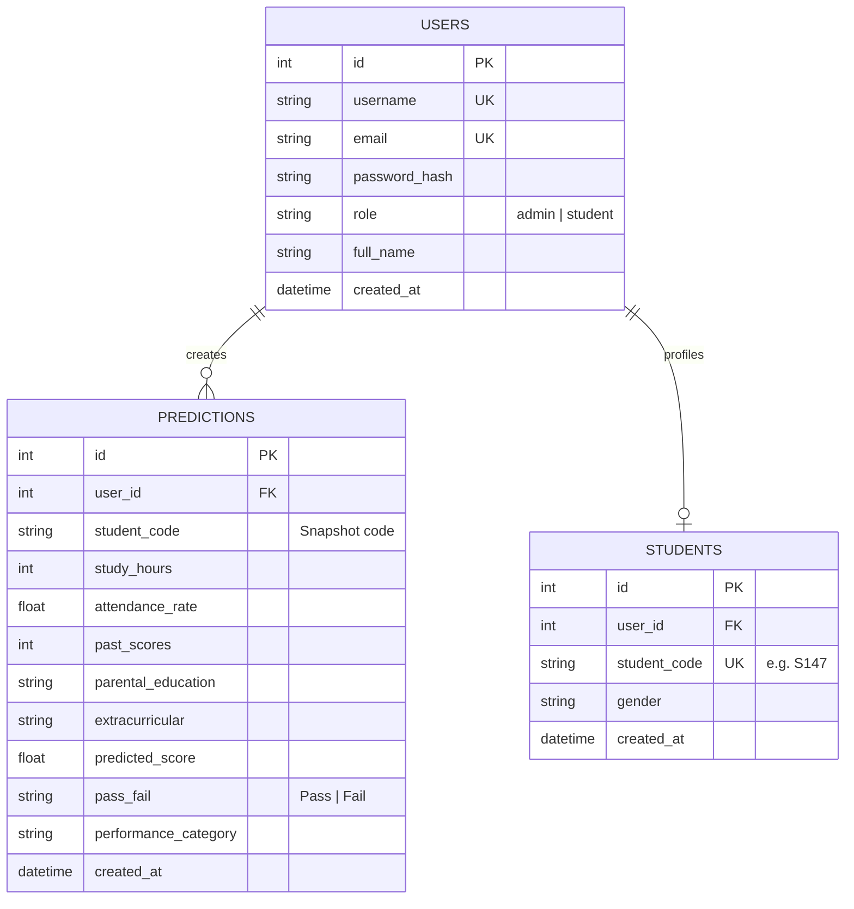

# Database Design Specification — MySQL

## 1. Schema Overview
The **Student Performance Predictor** employs a relational schema designed for MySQL 8.0+ (with SQLite resilience for zero-dependency local development and testing).

- **Database Name**: `student_predictor_db`
- **Engine**: InnoDB (supporting transactions and foreign key constraints)
- **Character Set**: `utf8mb4` (collation: `utf8mb4_unicode_ci`)

---

## 2. Entity-Relationship (ER) Architecture



---

## 3. Table Definitions & Data Dictionary

### Table 1: `users`
Stores credentials and role privileges for Administrators and Students.
- `id` (INT, Primary Key, AUTO_INCREMENT)
- `username` (VARCHAR(50), UNIQUE, NOT NULL): Login username.
- `email` (VARCHAR(100), UNIQUE, NOT NULL): Contact email address.
- `password_hash` (VARCHAR(255), NOT NULL): Cryptographically hashed password via salted SHA-256 (`scrypt`/`pbkdf2`).
- `role` (VARCHAR(20), NOT NULL, DEFAULT 'student'): Either `'admin'` or `'student'`.
- `full_name` (VARCHAR(100), NOT NULL): Full display name.
- `created_at` (DATETIME, DEFAULT CURRENT_TIMESTAMP).

### Table 2: `students`
Stores student profile metadata linked to user accounts.
- `id` (INT, Primary Key, AUTO_INCREMENT)
- `user_id` (INT, NULLABLE, FOREIGN KEY REFERENCES `users(id)` ON DELETE SET NULL).
- `student_code` (VARCHAR(30), UNIQUE, NOT NULL): Academic identifier (e.g., `S147`, `STU-2026-001`).
- `gender` (VARCHAR(20), NULLABLE): Optional profile attribute.
- `created_at` (DATETIME, DEFAULT CURRENT_TIMESTAMP).

### Table 3: `predictions`
Stores all prediction queries executed through the web application.
- `id` (INT, Primary Key, AUTO_INCREMENT)
- `user_id` (INT, NOT NULL, FOREIGN KEY REFERENCES `users(id)` ON DELETE CASCADE): Submitting user.
- `student_code` (VARCHAR(30), NOT NULL): Target student code snapshot.
- `study_hours` (INT, NOT NULL): Weekly study hours (10–40).
- `attendance_rate` (DECIMAL(5,2), NOT NULL): Attendance percentage (50.0–100.0%).
- `past_scores` (INT, NOT NULL): Previous examination score (50–100).
- `parental_education` (VARCHAR(50), NOT NULL): Categorical level.
- `extracurricular` (VARCHAR(10), NOT NULL): 'Yes' or 'No'.
- `predicted_score` (DECIMAL(5,2), NOT NULL): ML regression prediction.
- `pass_fail` (VARCHAR(10), NOT NULL): 'Pass' or 'Fail'.
- `performance_category` (VARCHAR(50), NOT NULL): e.g. 'Good (Grade B)'.
- `created_at` (DATETIME, DEFAULT CURRENT_TIMESTAMP, INDEXED).

---

## 4. Connection Configuration & Error Handling
Configuration is managed through environment variables in `.env`:

```env
DB_ENGINE=mysql
DB_USER=root
DB_PASSWORD=your_mysql_password
DB_HOST=localhost
DB_PORT=3306
DB_NAME=student_predictor_db
```

### Resilient Connectivity:
1. When MySQL server is online, the application connects via `mysql+pymysql://<user>:<password>@<host>:<port>/<dbname>`.
2. If MySQL credentials are incorrect, the service is not started, or tables are missing, the database module catches the exception, logs technical details, presents a clear user-friendly notification in the UI, and falls back cleanly to local SQLite (`student_predictor.db`).
3. This guarantees zero runtime crashes during demonstrations while maintaining 100% production-ready MySQL compatibility.
